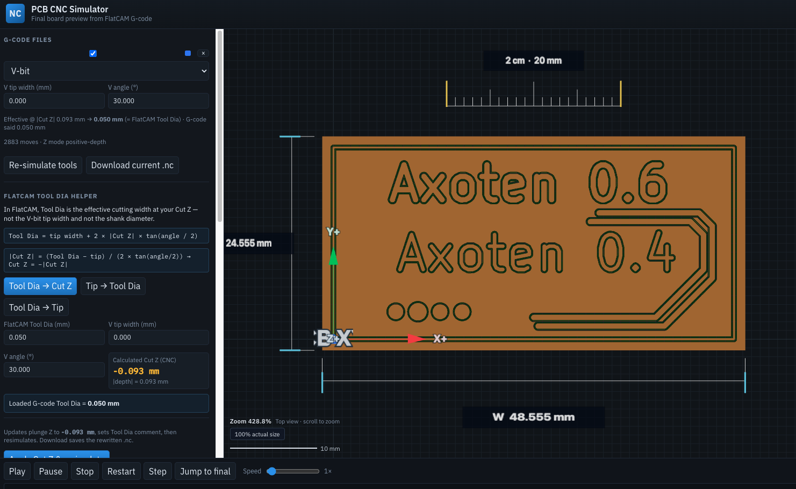

# PCB CNC Simulator

Web-based **3D PCB CNC G-code simulator** for FlatCAM `.nc` files. Shows the expected final board (copper + FR4 after milling), not only toolpath lines.



## Run

```bash
npm install
npm run dev
```

Open the app, then **Load sample** (or it auto-loads `00000_gcode-test-F_Cu.gbr_iso_combined_cnc.nc`).

**Open .nc** replaces any previously loaded job and resets stock, simulation, measurements, and helper fields.

## Features

- V-bit / end-mill / drill tools with depth-dependent V-bit width  
  `effectiveDiameter = tipDiameter + 2 × depth × tan(angle / 2)`
- **FlatCAM Tool Dia helper** (side panel): V tip width ≠ FlatCAM Tool Dia (effective width at Cut Z)
- Height-field material removal (copper mask + cut depth)
- Final PCB, toolpaths, heatmap, and combined views
- Top orthographic view with **zoom %**; **100% = actual size** (CSS 96 dpi) for ruler checks
- On-plot **2 cm comparison ruler** plus PCB **width / height** dimension lines
- Playback, warnings, and distance measurement
- G-code parsing / simulation in a Web Worker

## FlatCAM Tool Dia vs V tip width

FlatCAM’s **Tool Dia** is the **effective cutting width at Cut Z**, used for isolation offsets. It is **not** the physical V-tip width and not the shank (e.g. 3.175 mm).

```
FlatCAM Tool Dia = V tip width + 2 × |Cut Z| × tan(angle / 2)
|Cut Z|          = (Tool Dia − tip) / (2 × tan(angle / 2))
Cut Z            = −|Cut Z|   (standard CNC)
```

### Rewrite G-code from Tool Dia

In the left **FlatCAM Tool Dia helper** → **Tool Dia → Cut Z**:

1. Enter desired Tool Dia, V tip width, and V angle  
2. See calculated **Cut Z (negative)**  
3. **Apply Cut Z & resimulate** — rewrites plunge Z + comments, then resims  
4. **Download updated .nc** — same rewrite, saves a file  

## Sample test

```bash
npm run test:sample
```

The bundled isolation sample comments `TOOL DIAMETER: 0.05 mm` with `Z_Cut: 0.0933 mm` → at 30° that implies tip ≈ **0 mm** and effective groove ≈ **0.050 mm**.
